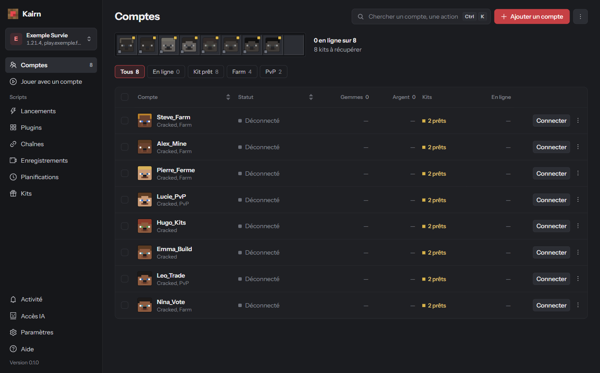

# Comptes

Ici, vous ajoutez vos comptes, les connectez et suivez ce qu'ils font. La page **Comptes** liste les
comptes du serveur choisi en haut à gauche : chaque serveur a ses propres comptes.

## Ajouter un compte

Bouton **Ajouter un compte**, puis choisissez le type :

- **Premium (Microsoft)** : l'adresse e-mail du compte Microsoft. Juste après, une fenêtre vous donne
  un code à saisir sur la page de Microsoft (voir [Connecter un compte Microsoft](#connecter-un-compte-microsoft)).
- **Cracked** : un **pseudo** (3 à 16 caractères : lettres, chiffres, `_`), pour les serveurs en mode
  cracked (offline) uniquement.

{: .astuce }
Votre mot de passe Microsoft n'est jamais demandé.

{: .attention }
Le type d'un compte (premium ou cracked) ne change plus après sa création.

### Les options du compte

| Option | Ce qu'elle fait |
|---|---|
| **Mot de passe du serveur** | Envoyé avec `/login` une fois le bot arrivé. Il est chiffré par Windows. |
| **Mode rejoint à la connexion** | Un des [modes de jeu](serveurs.html#ajouter-des-modes-de-jeu) du serveur, ou rester au point d'arrivée. |
| **Proxy** | SOCKS5, SOCKS4 ou HTTP (CONNECT), avec utilisateur et mot de passe si besoin (pas de mot de passe en SOCKS4). |
| **Reconnexion automatique** | Reconnecte le bot après une déconnexion, jamais après un bannissement. |
| **Anti-AFK** | Le bot regarde autour de lui et fait un aller-retour de 4 blocs toutes les 1 à 4 minutes ; il se met en pause quand un script utilise le compte. |

{: .note }
La connexion Microsoft, elle, ne passe pas par le proxy.

## Connecter un compte Microsoft

Pour un compte premium : **Se connecter à Microsoft**, puis dans la fenêtre :

1. **Ouvrir la page Microsoft** (ou copiez son adresse) ;
2. saisissez le code affiché (bouton **Copier**) ;
3. connectez-vous avec le compte Microsoft voulu.

La fenêtre se ferme toute seule une fois connecté.

{: .attention }
Le code expire au bout de quelques minutes : recommencez s'il a expiré.

{: .note }
La session reste enregistrée. **Modifier** › **Se déconnecter** l'oublie (il faudra un nouveau code).

## Connecter et suivre ses comptes

Sur chaque ligne : **Connecter** / **Déconnecter**, et le menu **⋯** : Console, Jouer avec ce compte,
Modifier, Supprimer.

{: .note }
Les connexions se font quelques-unes à la fois (réglable dans [Paramètres](parametres.html#régler-les-bots)).

### Lire le tableau

- **La barre d'objets**, en haut, montre un compte par case : sa tête, son statut (petit carré en
  bas à gauche) et un carré doré si un kit est prêt. Un clic ouvre sa fiche.
- **Filtres** : Tous, En ligne, Kit prêt, et un filtre par tag (plusieurs tags : les comptes qui
  les ont tous).
- **Colonnes** : Compte, Statut, vos [valeurs suivies](serveurs.html#suivre-largent-les-gemmes-et-autres-valeurs)
  (avec le total pour les nombres), Kits, temps En ligne.

### Comprendre les statuts

Déconnecté, En file d'attente, Authentification…, Connexion au serveur…, En ligne, Reconnexion
prévue, Erreur.

{: .astuce }
Survolez un statut pour voir la cause et le prochain essai.

## Agir sur plusieurs comptes

Cochez des lignes : une barre apparaît avec **Connecter**, **Déconnecter**, **Lancer un script**,
**Récupérer les kits**, et **Plus** (ajouter ou retirer des tags, exporter, supprimer).

## Voir la fiche d'un compte

Un clic sur un compte ouvre sa fiche, à droite. Elle a quatre onglets :

- **Aperçu** : ce que le serveur affiche sur ce compte (grade, argent…), ses kits, ses derniers messages ;
- **Console** : le chat du bot en direct ; écrivez un message ou une `/commande` (le compte doit
  être en ligne) ;
- **Kits** : chaque kit, prêt ou dans combien de temps, et combien de fois il a été récupéré ;
- **Stats** : temps en ligne (total et 7 jours), kits, dons, échanges, objets reçus, expulsions,
  déconnexions, et les derniers incidents.

## Ranger ses comptes avec des tags

Menu **⋯** › **Gérer les tags** : créez des tags (nom et couleur) pour ranger vos comptes, puis
ajoutez-les depuis la fiche ou la sélection.

{: .note }
Supprimer un tag ne supprime pas les comptes.

## Importer et exporter des comptes

### Reprendre un compte d'un autre serveur

**Ajouter un compte** › **D'un autre serveur**, choisissez le serveur puis les comptes (ou **Tous**).
Ils arrivent avec leur mot de passe de serveur, leur proxy et leurs tags, sans rien retaper ; les
comptes Microsoft restent connectés.

### Exporter dans un fichier

Menu **⋯** de la page › **Exporter des comptes** : tous les comptes du serveur ou la sélection, dans
un fichier. Cochez **Inclure les mots de passe** pour y mettre les mots de passe de serveur et de proxy.

{: .attention }
Avec les mots de passe, le fichier n'est **pas chiffré** : gardez-le pour vous.

{: .note }
Les sessions Microsoft ne sont jamais exportées.

### Importer un fichier

Menu **⋯** de la page › **Importer des comptes** : un fichier exporté par Kairn. Un rapport liste les
comptes importés et ceux ignorés (déjà présents, par exemple).

## Et ensuite ?

Réglez ce qui est propre à votre serveur (modes de jeu, kits, argent affiché) dans
[Serveurs](serveurs.html), puis faites travailler vos comptes avec les [scripts](scripts.html).
