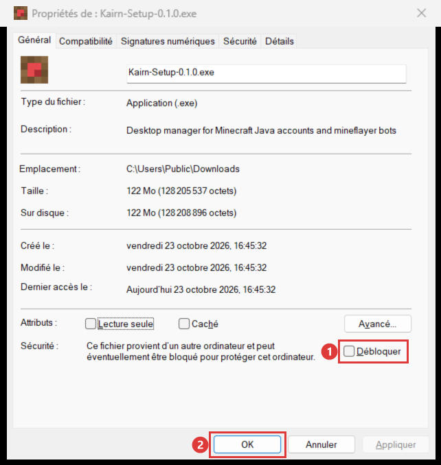

  
  <h1>Kairn</h1>
  
Vos comptes Minecraft Java, Microsoft ou cracked, au travail depuis votre PC : des dizaines de bots connectés, kits récupérés, scripts, chaînes d’actions, enregistrements rejoués… et vous-même en jeu avec n’importe lequel de vos comptes.

  <a class="btn btn-primary" href="https://github.com/kairnmc/kairn-releases/releases/latest">Télécharger Kairn</a>
  <a class="btn" href="#démarrer-en-4-étapes">Premiers pas</a>

## Démarrer en 4 étapes

<ol class="kairn-steps">
  <li><strong>Installer Kairn</strong> Téléchargez le dernier installateur, <code>Kairn Setup x.y.z.exe</code>, et lancez-le. <a href="#installer-kairn">Détails et blocage Windows</a></li>
  <li><strong>Activer Kairn</strong> Envoyez l’identifiant de votre PC à l’auteur de Kairn, puis collez le code d’accès qu’il vous renvoie. <a href="#activer-kairn">Comment faire</a></li>
  <li><strong>Ajouter un serveur</strong> Bouton <strong>Ajouter un serveur</strong> (ou le sélecteur de serveur en haut à gauche) : donnez son adresse, puis <strong>Détecter</strong> pour trouver sa version. <a href="{{ 'serveurs.html' | relative_url }}">Les serveurs</a></li>
  <li><strong>Ajouter et connecter un compte</strong> Page <strong>Comptes</strong>, bouton <strong>Ajouter un compte</strong>, puis <strong>Connecter</strong> sur sa ligne : son statut passe à <strong>En ligne</strong>. <a href="{{ 'comptes.html' | relative_url }}">Les comptes</a></li>
</ol>

{: .astuce }
<kbd>Ctrl</kbd> + <kbd>K</kbd> ouvre la recherche rapide de partout dans Kairn (comptes, pages, actions).

## Que voulez-vous faire ?

  <a class="kairn-card" href="{{ 'comptes.html' | relative_url }}">👥<strong>Gérer mes comptes</strong>Ajouter, connecter, ranger et suivre vos comptes.</a>
  <a class="kairn-card" href="{{ 'serveurs.html' | relative_url }}">🌍<strong>Préparer un serveur</strong>Modes de jeu, kits, argent et gemmes affichés.</a>
  <a class="kairn-card" href="{{ 'scripts.html' | relative_url }}">⚙️<strong>Automatiser</strong>Plugins, planifications, chaînes, enregistrements, kits.</a>
  <a class="kairn-card" href="{{ 'jouer.html' | relative_url }}">🎮<strong>Jouer avec un compte</strong>Depuis votre Minecraft, avec n’importe quel compte.</a>
  <a class="kairn-card" href="{{ 'ia.html' | relative_url }}">🤖<strong>Utiliser une IA</strong>Laisser une IA piloter Kairn, ou en donner une aux plugins.</a>
  <a class="kairn-card" href="{{ 'parametres.html' | relative_url }}">🎛️<strong>Régler Kairn</strong>Apparence, bots, mises à jour, vos données.</a>
  <a class="kairn-card" href="{{ 'plugins.html' | relative_url }}">🧩<strong>Écrire un plugin</strong>Pour les développeurs : l’API des plugins.</a>
  <a class="kairn-card" href="{{ 'faq.html' | relative_url }}">❓<strong>Résoudre un problème</strong>Les questions fréquentes.</a>

## Installer Kairn

1. Téléchargez le dernier installateur : [Kairn Setup](https://github.com/kairnmc/kairn-releases/releases/latest)
   (fichier `Kairn Setup x.y.z.exe`).
2. Lancez-le. Kairn s'installe dans votre session Windows et s'ouvre tout seul.

{: .note }
Pas besoin de droits administrateur.

### Si Windows bloque l'installateur

L'installateur n'est pas encore signé : au premier lancement, Windows peut afficher
« **Windows a protégé votre ordinateur** ».

**Un lien « Informations complémentaires » apparaît** : cliquez dessus, puis sur **Exécuter quand même**.

**Seul le bouton « Ne pas exécuter » apparaît** (Windows réglé plus strictement) : fermez la fenêtre,
puis débloquez le fichier :

1. clic droit sur `Kairn-Setup-x.y.z.exe` › **Propriétés** ;
2. en bas de l'onglet **Général**, cochez **Débloquer** ①, puis **OK** ② ;
3. relancez le fichier : il s'installe normalement.

{: .note }
Seule la première installation est concernée : les mises à jour, téléchargées par Kairn lui-même,
s'installent sans cet avertissement. Kairn se met ensuite à jour tout seul : voir
[Mises à jour](parametres.html#garder-kairn-à-jour).

## Activer Kairn

Kairn s'utilise avec un **code d'accès personnel**, valable sur un seul PC.

1. Au premier lancement, l'écran **Activer Kairn** affiche l'**identifiant de ce PC**
   (6 groupes de 4 caractères). Cliquez sur **Copier**.
2. Envoyez cet identifiant à l'auteur de Kairn.
3. Il vous renvoie votre code, qui commence par `KRN1.` : collez-le dans **Code d'accès**, puis
   cliquez sur **Activer**.

{: .attention }
Un code ne marche que sur le PC pour lequel il a été créé : sur un autre PC, demandez-en un nouveau.

{: .note }
Kairn vérifie régulièrement que votre accès est toujours valable (au lancement, puis toutes les
heures). Il peut fonctionner 7 jours sans connexion ; au-delà, il demande de se reconnecter à
Internet. Kairn signale à son auteur les activations et les accès refusés (nom, PC, version).

Un souci d'activation ? Voir [Problèmes d'accès](faq.html#accès-et-activation).

## Et ensuite ?

Votre premier compte est en ligne ? Lancez des [scripts](scripts.html),
récupérez vos [kits](scripts.html#récupérer-les-kits), ou
[jouez avec un compte](jouer.html) depuis votre propre Minecraft.
