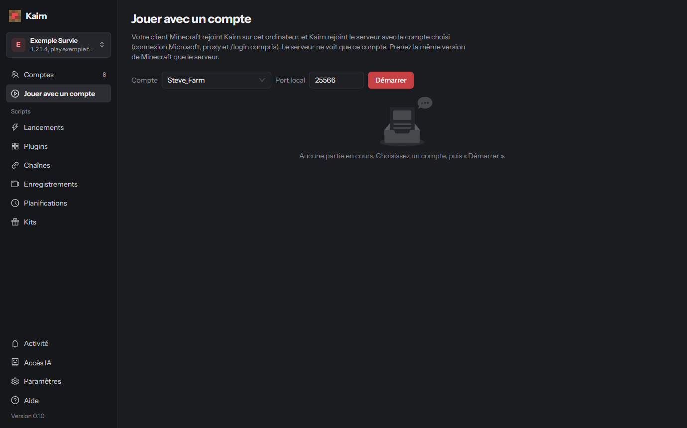

# Jouer avec un compte

Ici, vous jouez vous-même avec n'importe lequel de vos comptes, depuis votre propre Minecraft. Votre
client se connecte à Kairn sur votre PC, et Kairn rejoint le serveur avec le compte choisi (connexion
Microsoft, proxy et `/login` compris). Le serveur ne voit que ce compte.

## Lancer une partie

<ol class="kairn-steps">
  <li><strong>Choisir le compte</strong> Page <strong>Jouer avec un compte</strong> : choisissez le <strong>compte</strong> et le <strong>port local</strong> (25566 par défaut), puis <strong>Démarrer</strong>.</li>
  <li><strong>Se connecter depuis Minecraft</strong> Dans Minecraft, <strong>même version que le serveur</strong> : <strong>Multijoueur</strong> › <strong>Connexion directe</strong> › <code>127.0.0.1:25566</code> (bouton <strong>Copier</strong>).</li>
  <li><strong>Autoriser la connexion</strong> Kairn vous demande d’autoriser la connexion (« … veut jouer en tant que … ») : acceptez. Sans réponse, elle est refusée au bout de 25 secondes.</li>
</ol>

**Arrêter** termine la partie.

{: .attention }
Le compte ne doit pas être déjà connecté en bot : déconnectez-le avant.

## Enregistrer une partie

Pendant la partie : **Enregistrer** (nom facultatif), **Pause** / **Reprendre**, **Terminer**.
L'enregistrement arrive dans **Enregistrements**, prêt à être
[rejoué par d'autres comptes](scripts.html#rejouer-un-enregistrement).

### Depuis le chat du jeu

Vous pouvez aussi tout piloter en jeu, dans le chat :

| Commande | Effet |
|---|---|
| `/kairn rec [nom]` | commence à enregistrer |
| `/kairn pause` | met en pause |
| `/kairn reprise` | reprend |
| `/kairn stop` | termine et enregistre |

{: .note }
Ces commandes ne partent jamais au serveur.

## Ajouter des plugins d'interception

Facultatif : des plugins qui voient et modifient ce qui passe entre votre client et le serveur.
Ils se choisissent avant **Démarrer**.

{: .note }
10 plugins d'interception au plus par partie. Pour en écrire un : [Interception](plugins.html#interception-jouer-avec-un-compte).

## Et ensuite ?

Rejouez vos enregistrements avec d'autres comptes : [Rejouer un enregistrement](scripts.html#rejouer-un-enregistrement).
