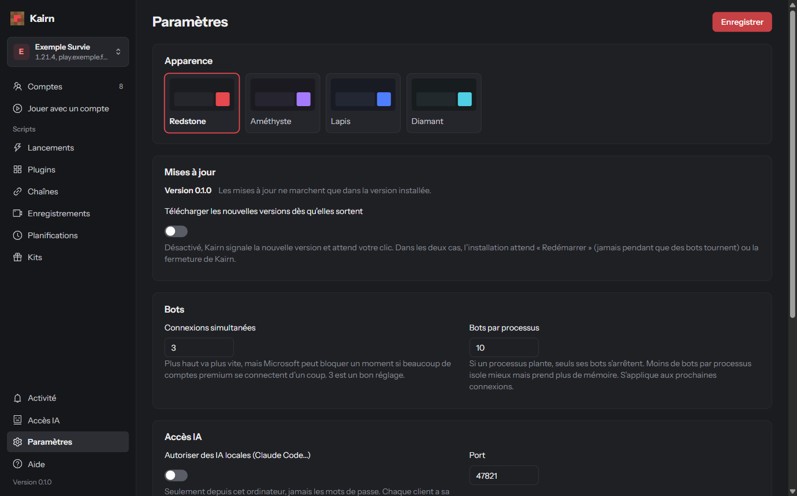

# Paramètres

Ici, vous adaptez Kairn à votre PC et à vos goûts. Dans la page **Paramètres**, modifiez puis
**Enregistrer**.

{: .note }
L'apparence s'applique tout de suite.

## Changer l'apparence

Quatre palettes : Redstone (par défaut), Améthyste, Lapis, Diamant.

## Régler les bots

| Réglage | Valeurs | Effet |
|---|---|---|
| **Connexions simultanées** | 1 à 10, 3 par défaut | Combien de comptes se connectent en même temps ; les autres attendent leur tour (« En file d'attente »). |
| **Bots par processus** | 1 à 50, 10 par défaut | Vaut pour les connexions suivantes. |

## Garder Kairn à jour

Kairn vérifie s'il existe une nouvelle version 15 secondes après son lancement, puis toutes les 6 heures.

- Par défaut, il vous la montre (dans **Activité** et ici) : **Télécharger**, puis **Redémarrer pour
  la vX**. Elle s'installe aussi quand vous fermez Kairn.
- **Télécharger les nouvelles versions dès qu'elles sortent** la télécharge en arrière-plan.
- **Vérifier maintenant** relance une vérification.

{: .note }
Le redémarrage attend que les bots soient déconnectés, les scripts finis et la partie en cours arrêtée.

## Accès IA et IA locale

Voir [Accès IA](ia.html).

## Raccourcis clavier

| Touches | Effet |
|---|---|
| <kbd>Ctrl</kbd> + <kbd>K</kbd> | Recherche rapide (comptes, pages, actions comme « Connecter tous les comptes »). |
| <kbd>↑</kbd> <kbd>↓</kbd> | Choisir dans la recherche rapide. |
| <kbd>Entrée</kbd> | Ouvrir. |
| <kbd>Échap</kbd> | Fermer. |

## Où sont vos données

Dans `%APPDATA%\Kairn` :

| Dossier | Contenu |
|---|---|
| `data\` | Comptes, réglages, kits, chaînes, enregistrements, statistiques… |
| `auth-cache\` | Les sessions Microsoft. |
| `plugins\` | Vos plugins et les plugins officiels. |

{: .note }
Les mots de passe (serveur, proxy) sont chiffrés par Windows et ne marchent que sur votre session.
Un fichier abîmé est mis de côté (`*.corrupt-<date>.json`) et Kairn vous le signale au lancement.

### Changer de PC

{: .important }
Exportez vos comptes (voir [Importer et exporter des comptes](comptes.html#importer-et-exporter-des-comptes))
et demandez un nouveau code d'accès (voir [Activer Kairn](index.html#activer-kairn)).

## Et ensuite ?

Un souci ? Les [questions fréquentes](faq.html) ont sans doute la réponse.
