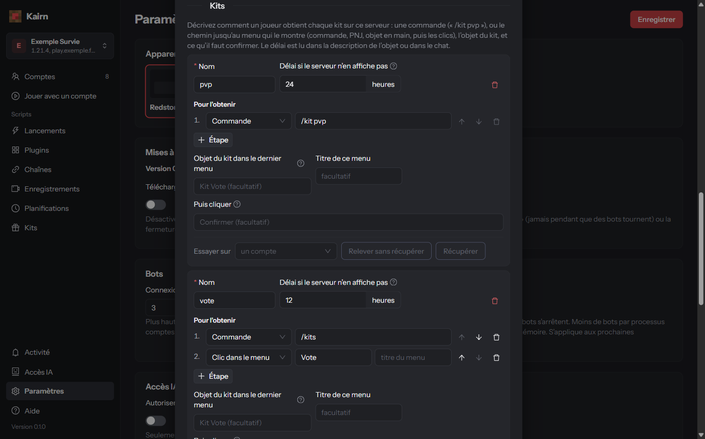

# Serveurs

Chaque serveur a son profil : son adresse, sa version, et tout ce qui varie d'un serveur à l'autre
(modes de jeu, kits, argent affiché…). Choisissez le serveur sur lequel vous travaillez avec le
sélecteur en haut à gauche ; **Modifier ce serveur…** ouvre son profil.

## Ajouter un serveur

**Ajouter un serveur…**, puis : un **nom**, l'**adresse** (port 25565 par défaut), la **version
Minecraft**. Le bouton **Détecter** demande sa version au serveur. Ensuite **Créer**. Les réglages
ci-dessous apparaissent quand vous modifiez le serveur.

## Modes de jeu

Les modes du serveur (Skyblock, Factions…) et comment les rejoindre, pour qu'un bot y aille tout seul :

- **Taper une commande** (par exemple `/skyblock`) ;
- ou **Choisir dans un menu** : clic droit sur un objet (boussole…) ou une commande qui ouvre le
  menu, puis l'objet à cliquer (une partie de son nom suffit).

**Arrivée confirmée par** : un changement de serveur, un message du chat, ou rien. Un compte peut
rejoindre un mode dès sa connexion (réglage du compte).

## Kits

Comment récupérer chaque kit sur ce serveur, puisque ça change partout :

- **Pour l'obtenir** : les étapes, dans l'ordre (voir [Étapes](#étapes)) ;
- **Objet du kit dans le dernier menu** et **titre de ce menu** ;
- **Puis cliquer** : les confirmations éventuelles (« Confirmer »…) ;
- **Délai si le serveur n'en affiche pas** : le temps à attendre entre deux récupérations.

**Essayer sur** un compte en ligne : **Relever sans récupérer** (lit le délai restant) ou
**Récupérer**, avec un journal de ce qui s'est passé. L'essai utilise le kit tel que vous l'écrivez,
sans l'enregistrer.

Les kits prêts se récupèrent depuis la page **Kits**, la sélection de comptes, ou la fiche d'un compte.

## Valeurs suivies

L'argent, les gemmes, les tokens… ne s'appellent pas pareil ni ne s'affichent au même endroit selon
les serveurs. Pour chaque valeur :

- un **nom** (« Gemmes ») ;
- la **source** : le scoreboard, l'action bar, la réponse à une commande (`/money`), ou un menu ;
- le **libellé** écrit à côté de la valeur sur le serveur ;
- **nombre** (pour additionner) et **colonne du tableau** (pour l'afficher dans Comptes) ;
- pour une commande ou un menu : la lire **toutes les N minutes**.

Le plus simple : **Écran de** un compte en ligne affiche ce que voit ce compte ; cliquez sur la ligne
qui contient la valeur, Kairn la reconnaît. Un aperçu montre la valeur lue. Une commande ou un menu
n'est lu que quand aucun script n'utilise le compte.

## Échanges

Les commandes et textes du `/trade` du serveur, pour les scripts qui échangent des objets entre
comptes : commande pour demander et pour accepter (`{player}` est remplacé par le pseudo), titre de
la fenêtre d'échange, bouton « accepter », message de réussite.

## Profil des comptes

Un **plugin de profil** lit ce que le serveur affiche pour chaque compte (grade, île…) ; ses champs
apparaissent dans l'aperçu des comptes. Voir [Écrire un plugin](plugins.html#plugin-de-profil).

## Étapes

Kits, menus et valeurs utilisent des **étapes** (8 au plus), faites dans l'ordre :

- **Commande** (`/kit`) ;
- **Clic sur un PNJ** (clic droit ou frapper), reconnu par le texte au-dessus de lui ;
- **Objet en main** (clic droit sur un objet de la barre) ;
- **Clic dans le menu** (avec, si besoin, le titre du menu attendu).

La première étape ne peut pas être un clic dans un menu.
